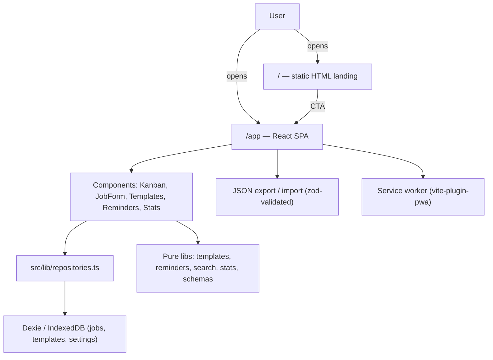

# JobPipe

> Free, no-signup, local-first job and freelance application tracker.

[](https://github.com/hamzabhulla/JobPipe/actions/workflows/ci.yml)
[](https://opensource.org/licenses/MIT)

**Live demo:** https://jobpipe.vercel.app — open the app at https://jobpipe.vercel.app/app


<!-- Hero GIF placeholder: record a 10–20 second walkthrough of the board
     and save it as docs/hero.gif. Do not ship a stock or AI-generated
     animation as if it were the app. -->

Job seekers and freelancers lose track of dozens of applications across LinkedIn, Upwork, Fiverr, and email. JobPipe gives you one clean board for all of them — no account, no server, no tracking.

## Features

- **Kanban board** — Saved, Applied, Interview, Offer, Rejected. Drag and drop, order persists, keyboard-accessible, mobile column-swipe view.
- **Full job form** — company, role, link, platform, type, rate, location, applied date, follow-up date, notes, tags, contact.
- **Proposal templates** — placeholders `{company}`, `{role}`, `{name}`, `{skills}`. Pick a template and a job, fill in your details, copy to clipboard.
- **Follow-up reminders** — overdue and due-today sections, snooze, done, and an optional browser notification (in-app panel is always the fallback).
- **Search, filter, sort** — text search plus status, platform, and tag filters; sort by newest, oldest, company, or follow-up date.
- **Statistics** — applications per week, response rate, and interview rate, drawn as lightweight SVG (no chart library).
- **JSON export/import** — versioned, zod-validated, with confirmation before any overwrite.
- **Dark/light theme** — system default, saved in `localStorage`.
- **Shortcuts** — `N` new job, `/` search, `Esc` close, `?` shortcuts help.
- **First-run empty state** — with a "Load sample data" option.
- **PWA** — installable, works offline after the first load.

## Why local-first

Most trackers hold your job search on someone else's server, behind an account you did not want. JobPipe inverts that:

1. **Your data stays with you.** Applications live in your browser's IndexedDB. There is no backend to breach, sell, or shut down.
2. **No account means no friction.** Open the app and track. No password, no email verification, no onboarding funnel.
3. **You own the backup.** Export is a plain JSON file you can read, keep, and re-import anywhere. No lock-in format.
4. **The trade-off is honest:** data lives in one browser. Clear that browser's data and it is gone unless you exported. That is why export is a first-class feature, not an afterthought.

## Screenshots

Replace the placeholders below with real screenshots of your build before publishing widely. Do not ship mockups as if they were the app.


## Quick start

Requirements: Node.js 20+, npm, git.

```bash
git clone https://github.com/hamzabhulla/JobPipe.git
cd JobPipe
npm install
npm run dev
```

Open http://localhost:5173/app/ in dev (note the trailing slash — in production, `/app` works without it, via the `vercel.json` rewrite).

```bash
npm test        # Vitest, 52 tests
npm run lint    # ESLint
npm run typecheck
npm run build   # regenerates sitemap.xml, typechecks, builds to dist/
npm run preview # serve the production build locally
```

## Tech stack

| Layer | Choice | Why |
|---|---|---|
| UI | React 18 + TypeScript (strict, no `any`) | Type-safe, widely known |
| Build | Vite 5 | Fast dev, multi-page build for SEO |
| Styling | Tailwind CSS 3 | Utility-first, one accent colour, CSS-variable tokens |
| Storage | Dexie.js (IndexedDB) | Local-first, indexed, versioned migrations |
| Drag and drop | dnd-kit | Accessible, keyboard-operable sorting |
| PWA | vite-plugin-pwa | Installable, offline app shell |
| Validation | zod | Import/export schemas, versioned envelope |
| Tests | Vitest + Testing Library + fake-indexeddb | Fast, real repository tests |

## Architecture



## Project structure

```
jobpipe/
├── index.html                 # Static, crawlable landing page (Step 5)
├── app/index.html              # React app entry (noindex)
├── privacy/index.html          # Static privacy page
├── about/index.html            # Static about page
├── changelog/index.html        # Static changelog page
├── public/                     # robots.txt, sitemap.xml, llms.txt, icons, OG image
├── scripts/generate-sitemap.mjs
├── src/
│   ├── App.tsx                 # App shell, state, shortcuts, import/export UI
│   ├── main.tsx                # Entry + service worker registration
│   ├── index.css               # Tailwind + design tokens
│   ├── lib/                    # db, repositories, types, templates, reminders,
│   │                           # search, stats, schemas, import-export, theme
│   ├── components/             # KanbanBoard, JobCard, JobForm, panels, dialogs
│   └── test/                   # Test setup + SEO tests
└── .github/workflows/ci.yml    # lint, typecheck, test, build
```

## SEO architecture (why this shape)

A client-rendered SPA is weak for SEO, so JobPipe is a Vite **multi-page build**, not a prerender plugin:

- `/` is hand-written static HTML — real H1, features, how-it-works, privacy, FAQ, comparison, author section, and JSON-LD. It does not depend on JavaScript.
- `/app` is the React app, with `noindex` meta. `robots.txt` intentionally does **not** disallow `/app`: a disallow would stop crawlers from reading the `noindex` tag, which can leave the URL listed without a snippet. Allowing the crawl lets the `noindex` be honoured.
- `/privacy`, `/about`, `/changelog` are static pages with unique titles/descriptions, canonical URLs, and `BreadcrumbList` JSON-LD.
- `scripts/generate-sitemap.mjs` regenerates `public/sitemap.xml` on every build (only indexable pages, absolute URLs, ISO 8601 `lastmod`).
- `public/robots.txt` allows all normal crawlers, explicitly allows major AI crawlers (GPTBot, OAI-SearchBot, ChatGPT-User, ClaudeBot, Claude-SearchBot, PerplexityBot, Google-Extended, Applebot-Extended, CCBot), and references the sitemap. To disallow any one bot, add a bot-specific `Disallow: /` block above the generic block — see the comment in the file.
- `public/llms.txt` and `public/llms-full.txt` follow the llms.txt convention (H1, blockquote summary, linked sections; full text without marketing fluff).
- JSON-LD on the landing page: `WebSite`, `Person` (author), `SoftwareApplication` (BusinessApplication, price 0 USD, MIT, code repository), and `FAQPage` whose questions and answers match the visible FAQ text exactly.

**Intentionally left out of JSON-LD, and why:**

- `aggregateRating` / `review` — JobPipe has no user ratings yet. Adding them would be fake structured data and a Rich Results violation.
- `screenshot` — no published screenshot asset is claimed yet; add it only once a real screenshot exists.
- `offers.availability` — JobPipe is not sold through a store; price 0 USD already states it is free.

**OG image:** the template is `public/og-image.svg` (1200×630). The PNG used by `og:image` is `public/og-image.png`, generated from the same design. To regenerate after editing the SVG, export at exactly 1200×630, for example with Inkscape:

```bash
inkscape public/og-image.svg --export-type=png --export-filename=public/og-image.png -w 1200 -h 630
```

Or open the SVG in a browser at 1200×630 and screenshot it. Do not change the PNG dimensions — social platforms expect 1200×630.

## Privacy statement

JobPipe has no backend, no accounts, and no analytics. Your applications, templates, and settings are stored only in your browser's IndexedDB. Export downloads a JSON file to your device; import reads a file you chose. Clearing browser site data deletes all JobPipe data. Full text: [/privacy](https://jobpipe.vercel.app/privacy).

## Deployment (Vercel)

1. Import `hamzabhulla/JobPipe` in Vercel.
2. Framework Preset: **Vite**. Build Command: `npm run build`. Output Directory: `dist`. Install Command: `npm install`.
3. No environment variables are required.
4. Deploy. Every push to `main` redeploys automatically.

`vercel.json` in the repo already sets `/app` rewrites, security headers (CSP, `X-Content-Type-Options`, `Referrer-Policy`, `Permissions-Policy`), and long-cache headers for hashed assets. Note: the `/app` CSP allows `style-src 'unsafe-inline'` because dnd-kit sets drag transforms as inline styles; script sources remain `'self'` only.

## Roadmap

- [ ] Cloud sync with a private key (optional, end-to-end encrypted by design — not yet started)
- [ ] Browser extension (save a posting to JobPipe in one click)
- [ ] Optional bring-your-own-key AI drafts (proposal drafts only, never auto-sent, key stored locally)
- [ ] CSV export
- [ ] Per-job interview notes timeline

## Contributing

Contributions are welcome. Please:

1. Fork, branch from `main`, and keep changes focused.
2. Run `npm run lint`, `npm run typecheck`, and `npm test` before opening a PR.
3. Add or update tests for behaviour changes (see `src/**/*.test.*`).
4. Do not add a backend, account system, analytics, or tracking — those are out of scope by design. Open an issue first for larger features.

## License

MIT — see [LICENSE](LICENSE). Copyright (c) 2026 Hamza Bhulla.

---

### For the repository settings (paste these)

**Description to paste into GitHub → Settings → About:**

```
JobPipe — free, no-signup, local-first job and freelance application tracker
```

**GitHub topics to add:**

```
job-tracker, freelance, kanban, local-first, pwa, react, typescript, vite, dexie, indexeddb, open-source, job-search, productivity
```

**Author:** Hamza Bhulla — [github.com/hamzabhulla](https://github.com/hamzabhulla) · [hamzabhulla.vercel.app](https://hamzabhulla.vercel.app)
